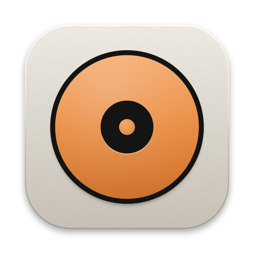
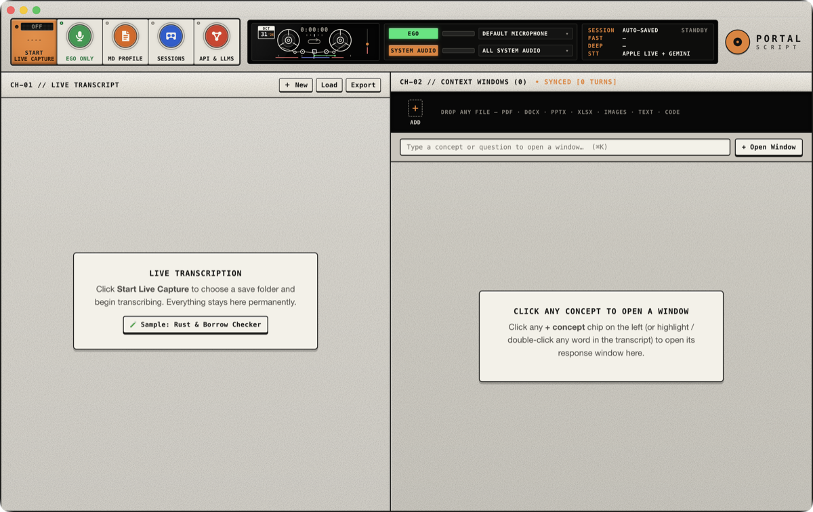
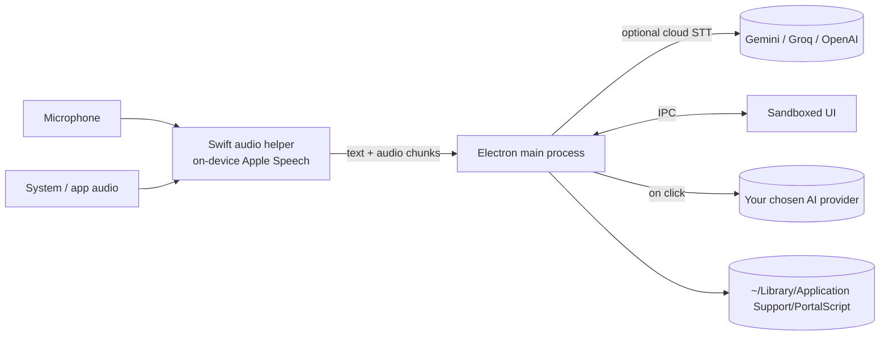

<p align="center"></p>

<h1 align="center">PortalScript</h1>

<p align="center">Live transcription and an on-demand AI explainer for meetings, interviews and videos on macOS.</p>

<p align="center">
  <a href="https://palolz.github.io/PortalScript/">Website</a> ·
  <a href="https://github.com/palolz/PortalScript/releases/latest">Download</a> ·
  <a href="docs/guide/README.md">User guide</a> ·
  <a href="docs/PRIVACY.md">Privacy</a> ·
  <a href="docs/TERMS.md">Terms</a>
</p>



- Transcribes your microphone ("Ego") and your Mac's audio, or a single app's audio, side by side.
- **Interview: AUTO** spots questions as they're asked and shows a quick answer right away, with a
  detailed answer (and a flowchart when it helps) loading underneath.
- Optional speaker tracking tells people apart, even several voices on the same call.
- Security jargon and abbreviations (SIEM, EDR, MFA…) are explained the moment they're said.
- Click any line to get an answer to what was just asked. Highlight a phrase to open it in a context window.
- Bring your own AI provider: Gemini, OpenAI, Anthropic, Groq, OpenRouter, a local Ollama model, or any OpenAI-compatible endpoint.
- Sessions, transcripts and recordings stay in a private folder on your Mac.

## Install

Requires macOS 14 (Sonoma) or later.

1. Download the DMG from [Releases](https://github.com/palolz/PortalScript/releases/latest):
   `arm64` for Apple Silicon, `x64` for Intel.
2. Drag **PortalScript** into Applications.
3. The app isn't notarized by Apple yet, so the first launch is blocked. Open it once, then go to
   **System Settings → Privacy & Security** and click **Open Anyway**.
4. Allow **Microphone**, **Screen & System Audio Recording** and **Speech Recognition** when asked.
5. Open **API & LLMs** and add a key for the provider you want to use.

### Verify the download

Every release lists SHA-256 checksums and is built by GitHub Actions with a signed
[build provenance attestation](https://docs.github.com/actions/security-guides/using-artifact-attestations-to-establish-provenance-for-builds).

```sh
shasum -a 256 -c SHA256SUMS.txt --ignore-missing
gh attestation verify PortalScript-1.1.0-arm64.dmg --repo palolz/PortalScript
```

The second command proves the DMG was built from this repository's source by the release workflow,
not on someone's laptop.

## How it works



- [User guide](docs/guide/README.md): step-by-step how-tos with screenshots.
- [Changelog](CHANGELOG.md): what's new in each version.
- [Architecture](docs/ARCHITECTURE.md): processes, data flow and sequence diagrams.
- [Privacy](docs/PRIVACY.md): every file the app touches and everything it sends over the network.

## Build from source

You need Xcode Command Line Tools and Node.js 22.

```sh
git clone https://github.com/palolz/PortalScript.git
cd PortalScript
npm ci
npm start          # build helpers + UI, then run
npm run dist       # build DMGs into release/
```

## Contributing

Bug reports and pull requests are welcome. See [CONTRIBUTING.md](CONTRIBUTING.md).
Report security issues privately, as described in [SECURITY.md](SECURITY.md).

## License

[PolyForm Noncommercial 1.0.0](LICENSE). Free to use, study, modify and share for any noncommercial
purpose. Selling it, or using it as part of a paid product or service, is not allowed.
For anything else, ask the author.

## Contact

Palol Zaman · [portal.script.contact@gmail.com](mailto:portal.script.contact@gmail.com) · [LinkedIn](https://www.linkedin.com/in/palol-zaman-bab8b9141/) · [Terms of use](docs/TERMS.md) · [Impressum](https://hatfullofsoftware.com/impressum.html) · [Datenschutz](https://hatfullofsoftware.com/datenschutz.html)
