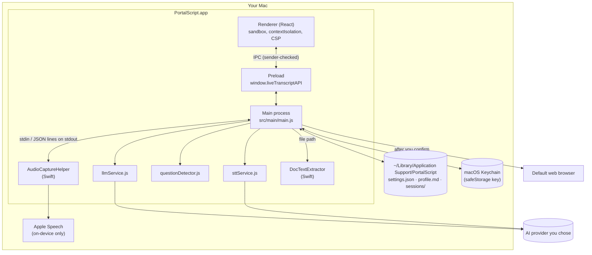
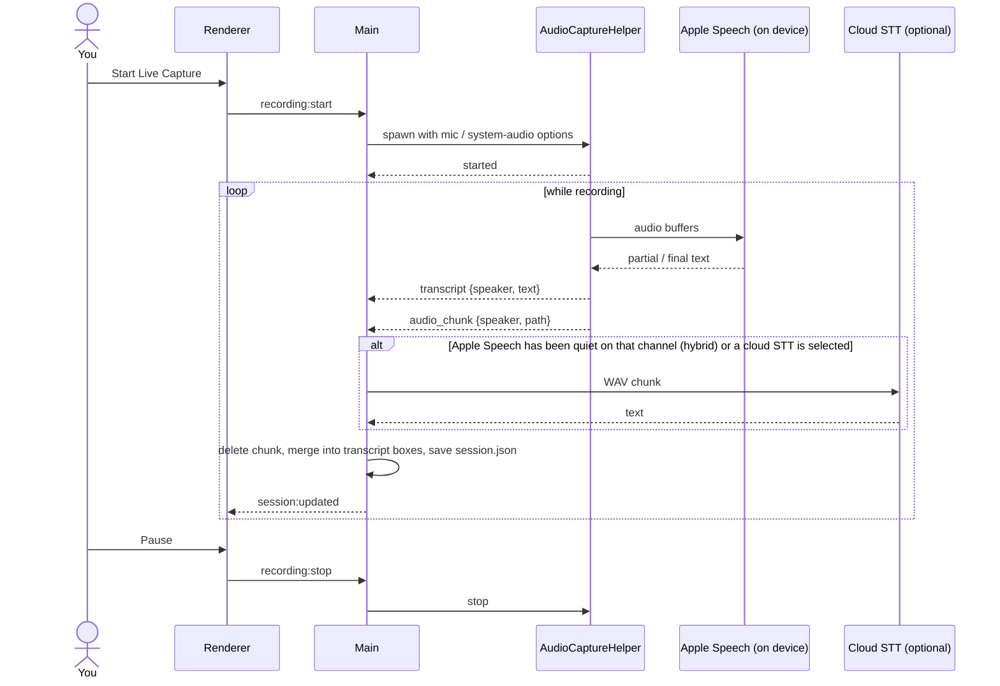
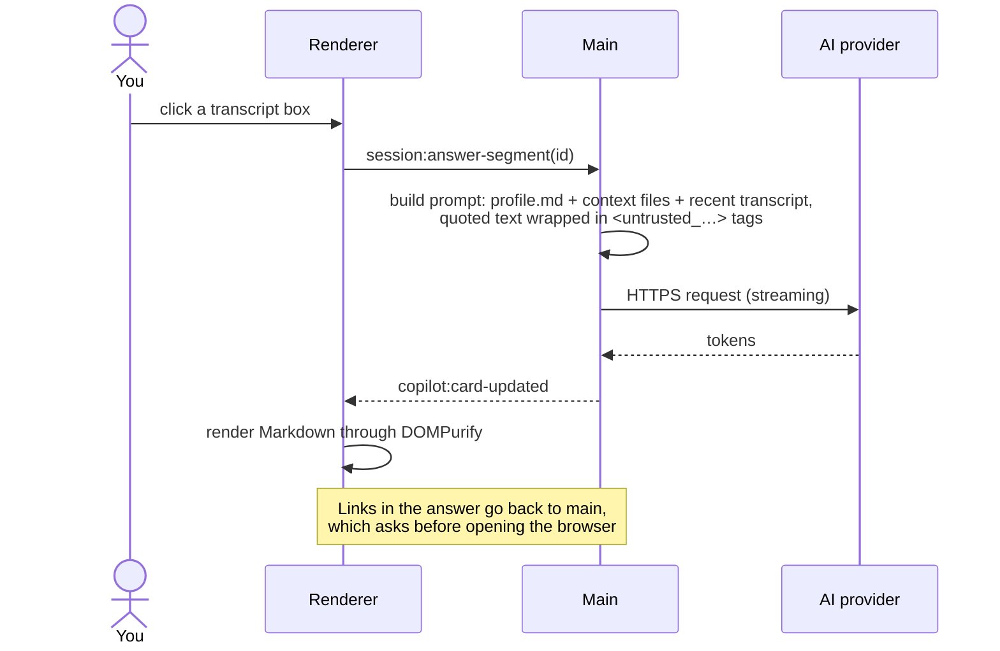
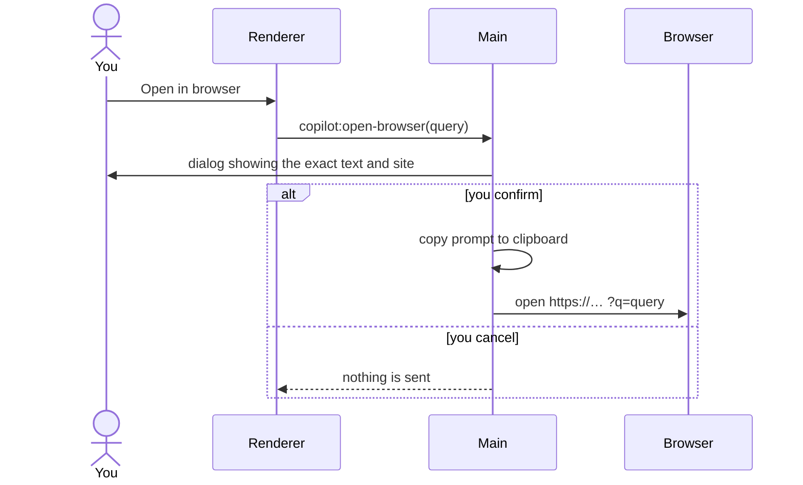

# Architecture

PortalScript is an Electron app with two small Swift command-line helpers. Everything with access to the
file system, the network or API keys runs in the main process. The UI runs in a sandboxed renderer and
can only call a fixed list of IPC functions.

## Block diagram

## Processes

| Process            | Code                              | Can do                                                                                                                 |
| ------------------ | --------------------------------- | ---------------------------------------------------------------------------------------------------------------------- |
| Main               | `src/main/main.js`                | Files, network, spawning helpers, dialogs, keychain                                                                    |
| Renderer           | `src/renderer/`                   | Draw the UI. No Node.js, no network (`connect-src 'self'`), no navigation away from the app page                       |
| Preload            | `src/preload/preload.js`          | Expose a fixed set of IPC calls as `window.liveTranscriptAPI`                                                          |
| AudioCaptureHelper | `native/AudioCaptureHelper.swift` | Capture mic (AVFoundation) and system or per-app audio (ScreenCaptureKit), run on-device Apple Speech, write WAV files |
| DocTextExtractor   | `native/DocTextExtractor.swift`   | Pull text out of PDFs and images (PDFKit, Vision OCR)                                                                  |

### Helper protocol

The main process starts `AudioCaptureHelper` when you press Start and talks to it over stdio.

- **stdin** (main → helper): `stop`, `mute me|other`, `unmute me|other`, `sysapp <bundleId>|*`
- **stdout** (helper → main), one JSON object per line:
  `started`, `stopped`, `status`, `warning`, `error`, `level` (meters),
  `transcript` (Apple Speech text), `audio_chunk` (path to a short WAV for cloud speech-to-text),
  `devices`, `apps`

## Sequence: live capture

## Sequence: click a line for an answer

## Sequence: open in browser

## Security measures

- Renderer: `sandbox`, `contextIsolation`, no `nodeIntegration`, strict CSP, DevTools off in release builds.
- Every IPC handler rejects calls that don't come from the app's own page.
- Navigation, new windows, redirects and `<webview>` are blocked; web permissions are denied except clipboard write.
- AI output is untrusted: Markdown is sanitized with DOMPurify, only `http(s)` and `mailto` links survive, and opening one asks first.
- Text from speech and files is fenced as untrusted data in prompts to blunt prompt injection.
- API keys are encrypted with Electron `safeStorage` (Keychain-backed) and never sent to the renderer; the UI only sees masked values.
- Remote endpoints must be `https://`; plain `http://` is only accepted for `localhost`. HTTP redirects are refused.
- Links and endpoint addresses with a user name or password in them (`https://bank.com@evil.com`) are refused.
- `npm test` checks these rules in CI, including which host every API key and every audio upload goes to.
- Files are created owner-only (`umask 077`).
- Release builds flip Electron fuses: no `ELECTRON_RUN_AS_NODE`, no `NODE_OPTIONS` or `--inspect`, app code only from `app.asar`, with an integrity check.

## Source map

| Path                                 | What's in it                                                          |
| ------------------------------------ | --------------------------------------------------------------------- |
| `src/main/main.js`                   | Window, IPC, settings, sessions, helper management, prompts for cards |
| `src/main/llmService.js`             | Provider presets, model catalogs, streaming clients, prompt templates |
| `src/main/sttService.js`             | Cloud speech-to-text (Gemini, Groq Whisper, OpenAI Whisper)           |
| `src/main/questionDetector.js`       | Keyword chips and the "me vs. other" split for a single shared mic    |
| `src/main/security.js`               | Link and sender checks, settings filtering, key encryption on disk    |
| `src/main/sessionContext.js`         | Builds the fenced transcript + files block sent with AI requests      |
| `test/`                              | Unit tests (`npm test`), network replaced by a recording fake `fetch` |
| `src/preload/preload.js`             | The IPC bridge                                                        |
| `src/renderer/App.jsx`, `styles.css` | The whole UI                                                          |
| `native/`                            | Swift helpers and the helper's embedded `Info.plist`                  |
| `scripts/build-native.sh`            | Builds universal (arm64 + x86_64) helpers                             |
| `electron-builder.yml`               | Packaging, fuses, DMG                                                 |
