# PortalScript user guide

Step-by-step guides for the common ways to use PortalScript. The screenshots show demo data.

In the app, open this guide any time from **Help → PortalScript User Guide**.

- [1. Install and first launch](#1-install-and-first-launch)
- [2. Pick your AI and speech engine](#2-pick-your-ai-and-speech-engine)
- [3. Start a session](#3-start-a-session)
- [4. Online meeting (Zoom, Teams, Meet)](#4-online-meeting-zoom-teams-meet)
- [5. YouTube, a lecture or a podcast](#5-youtube-a-lecture-or-a-podcast)
- [6. In-person conversation on one mic](#6-in-person-conversation-on-one-mic)
- [7. Dictate your own notes](#7-dictate-your-own-notes)
- [8. Interview help](#8-interview-help)
- [9. Find, export and reopen sessions](#9-find-export-and-reopen-sessions)
- [Keyboard shortcuts](#keyboard-shortcuts)

## Which setup do I need?

| Situation                  | EGO (your mic) | SYSTEM AUDIO       | EGO ONLY |
| -------------------------- | -------------- | ------------------ | -------- |
| Online meeting             | On             | On, set to the app | On       |
| YouTube, lecture, podcast  | Off            | On, set to browser | —        |
| In person, one mic in room | On             | Off                | Off      |
| Dictating notes            | On             | Off                | On       |

Click **EGO** or **SYSTEM AUDIO** to turn a channel on or off. A crossed-out label means it's off.

## 1. Install and first launch

1. Download the DMG for your Mac from [Releases](https://github.com/palolz/PortalScript/releases/latest):
   `arm64` for Apple Silicon, `x64` for Intel.
2. Drag **PortalScript** into **Applications** and open it.
3. macOS blocks the first launch because the app isn't notarized yet. Go to
   **System Settings → Privacy & Security** and click **Open Anyway**.
4. Allow **Microphone**, **Screen & System Audio Recording** and **Speech Recognition** when asked.
   You can change these later in **System Settings → Privacy & Security**.

The app opens with an empty transcript on the left and the context windows on the right.

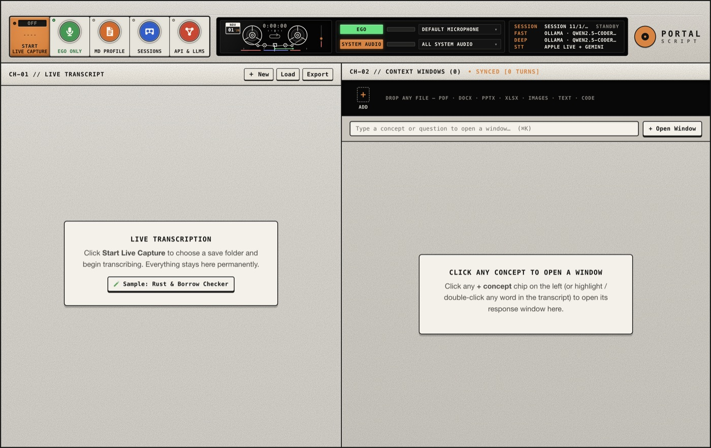

The top bar, left to right:

- **START LIVE CAPTURE**: start or pause listening (or press <kbd>Space</kbd>).
- **EGO ONLY**: on when your mic only hears you. Turn it off when one mic hears everyone in the room.
- **MD PROFILE**: a short Markdown note about you that the AI uses to tailor answers.
- **SESSIONS**: create, reopen and export sessions.
- **API & LLMS**: AI provider, keys and speech engine.
- The black panel shows the two input channels with their level meters, and which session, models
  and speech engine are active.

## 2. Pick your AI and speech engine

1. Click **API & LLMS**.
2. Choose a provider in **Primary LLM provider preset**: Google AI Studio, OpenAI, Anthropic, Groq,
   OpenRouter, a local Ollama model, or any OpenAI-compatible endpoint.
3. Paste your API key. It's encrypted with a key held in your macOS Keychain and only sent to that provider.
4. Leave **Speech transcription mode** on **Hybrid** unless you have a reason to change it. Apple's
   on-device speech recognition does the live text, with Gemini as a fallback.
5. Pick a **Fast** model (quick concept windows) and a **Deep** model (full answers).
6. Click **Test Selected Engines Now**, then **Save Settings**.

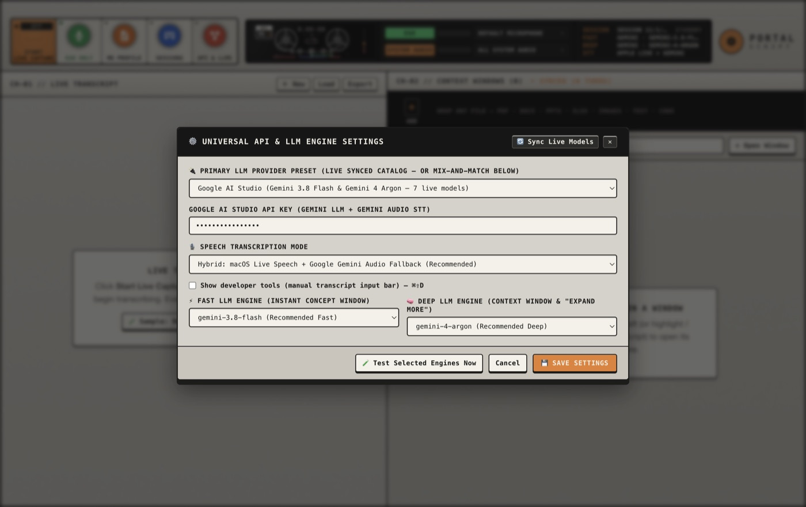

> No key? Choose **Ollama** and run a model locally, and set speech to
> **macOS On-Device Live Speech Only**. Then nothing leaves your Mac.

## 3. Start a session

Everything you capture goes into a session folder, saved automatically as you go.

1. Click **＋ New** above the transcript (or **New Session** in **SESSIONS**).
2. Give it a name. The default location is fine.
3. Click **Create New Session Folder & Start**.

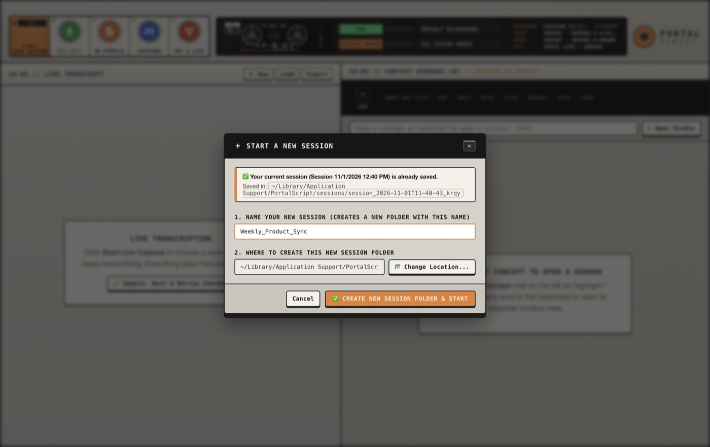

## 4. Online meeting (Zoom, Teams, Meet)

You want your voice on **EGO** and everyone else from the meeting app on **SYSTEM AUDIO**.

1. Make sure **EGO** and **SYSTEM AUDIO** are both on, and **EGO ONLY** is on.
2. Click the drop-down next to **SYSTEM AUDIO** and pick the meeting app. Only that app is captured,
   so notification sounds and music from other apps stay out of the transcript.

   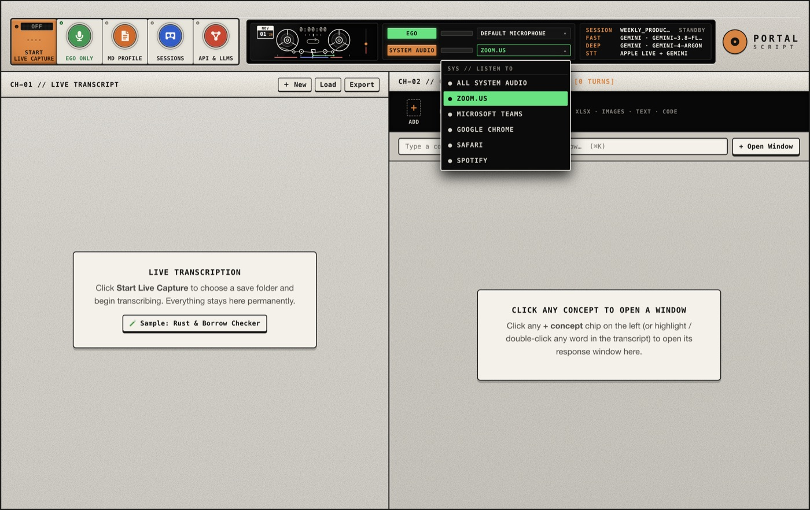

3. Press **START LIVE CAPTURE** (or <kbd>Space</kbd>).
4. Your lines appear indented with an **EGO** tag. Other people get a **SYS AUDIO** tag.

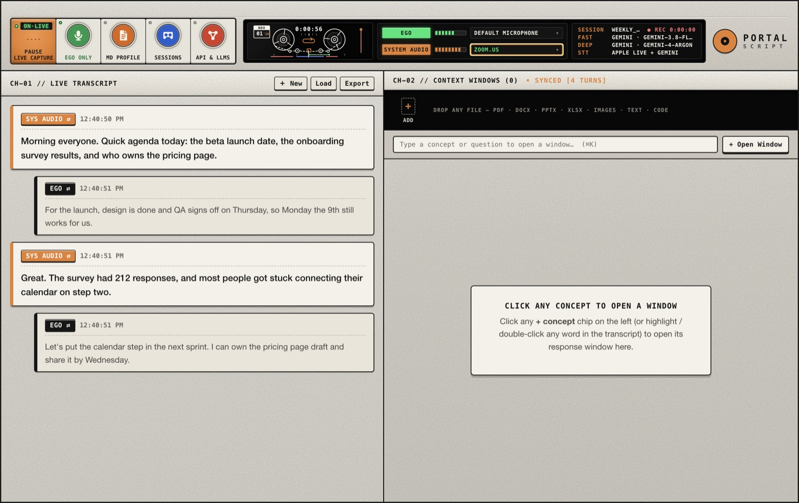

If a line lands on the wrong side, click its **EGO ⇄** / **SYS AUDIO ⇄** tag to flip it.

## 5. YouTube, a lecture or a podcast

1. Click **EGO** to turn your mic off (it shows crossed out).
2. Set **SYSTEM AUDIO** to your browser, for example **Google Chrome**.
3. Start capture and play the video.
4. Key terms get a **＋ chip** under the line. Click one to get a short explanation on the right.

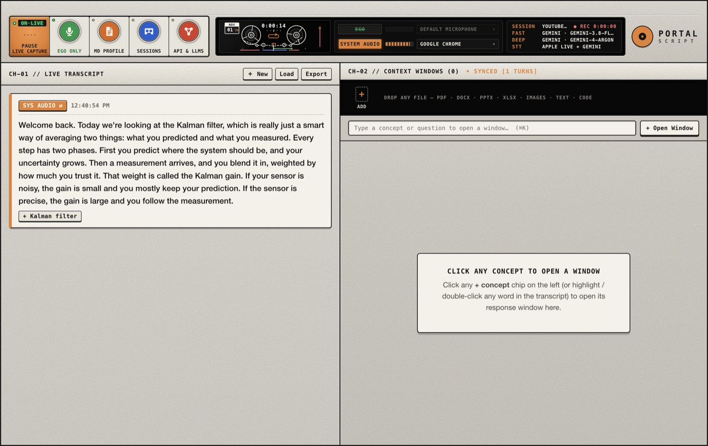

## 6. In-person conversation on one mic

When you and someone else share one Mac mic, PortalScript can split the voices by loudness.
The closer, louder voice is treated as you.

1. Turn **EGO ONLY** off. Its light goes dark.
2. Turn **SYSTEM AUDIO** off.
3. Start capture and put the Mac between you.
4. Flip any line that lands on the wrong side with its speaker tag.

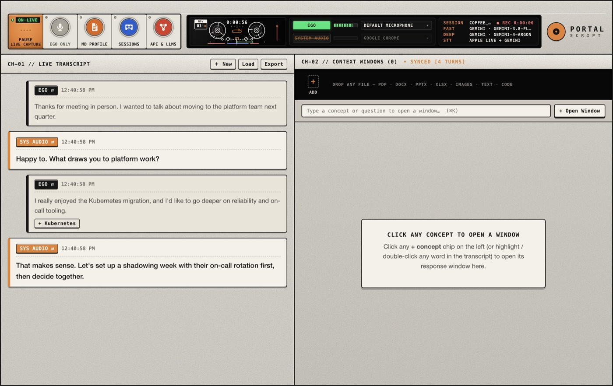

## 7. Dictate your own notes

1. Turn **EGO ONLY** on and **SYSTEM AUDIO** off.
2. Start capture and talk. Pause with <kbd>Space</kbd> when you need to think.
3. Export the session as Markdown or text when you're done (see [section 9](#9-find-export-and-reopen-sessions)).

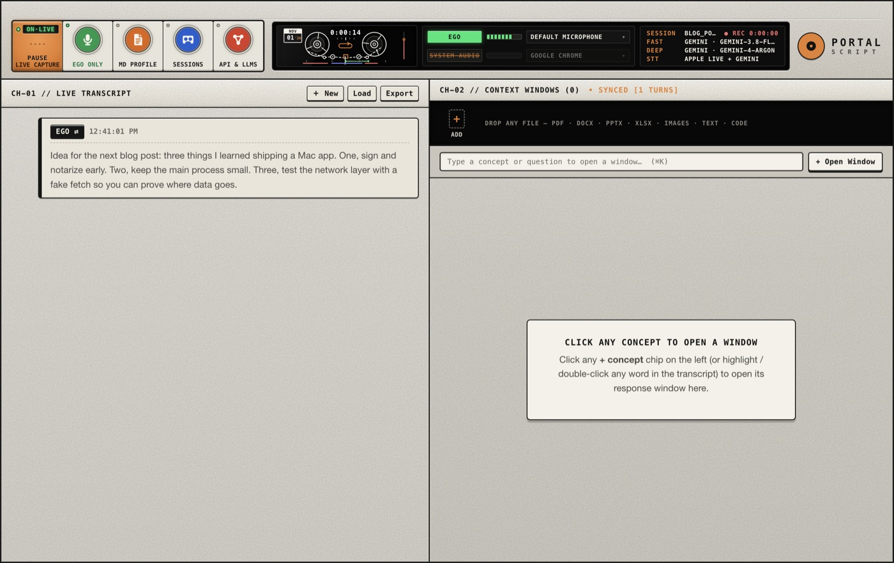

## 8. Interview help

Set this up before the call. During the interview, follow the [meeting](#4-online-meeting-zoom-teams-meet) setup.

### Add your profile

1. Click **MD PROFILE**.
2. Paste or type a short Markdown note: your role, experience, the projects you want to mention,
   and how you want answers phrased. Or click **Load .md File from Disk**.
3. Click **Save .md Profile**.

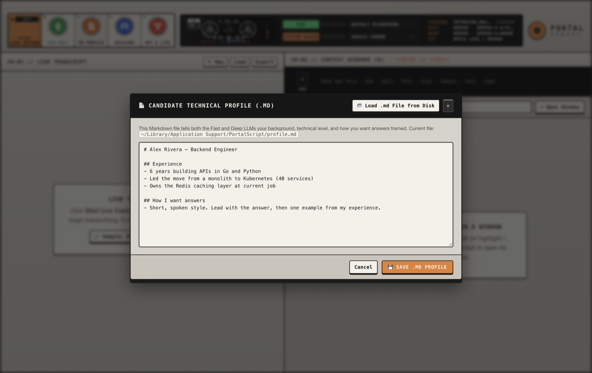

### Add context files

Give the AI the job description, company notes, or your CV.

1. Click **＋ ADD** in the strip on the right, or drag files onto it.
2. PDF, Word, PowerPoint, Excel, images, text and code files all work.
3. The files belong to this session. Hover over one and click **×** to remove it.

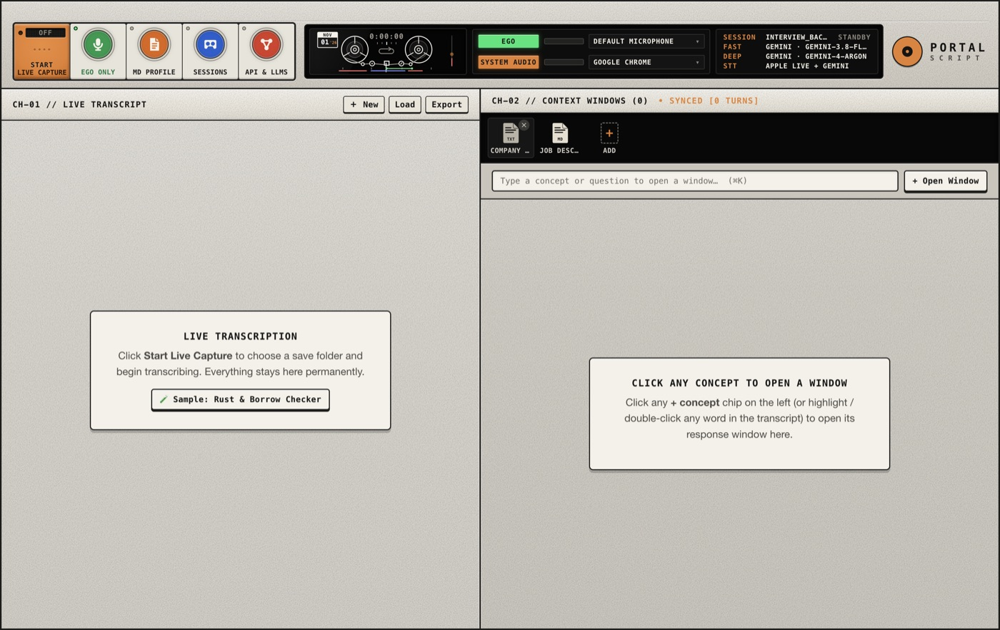

### Get an answer to a question

1. When the interviewer asks something, **click their line once**.
2. An **ANSWER** window opens on the right with a short answer, key points and a
   **Say it like this** line built from your profile.
3. Type in **Ask further clarification** to follow up.

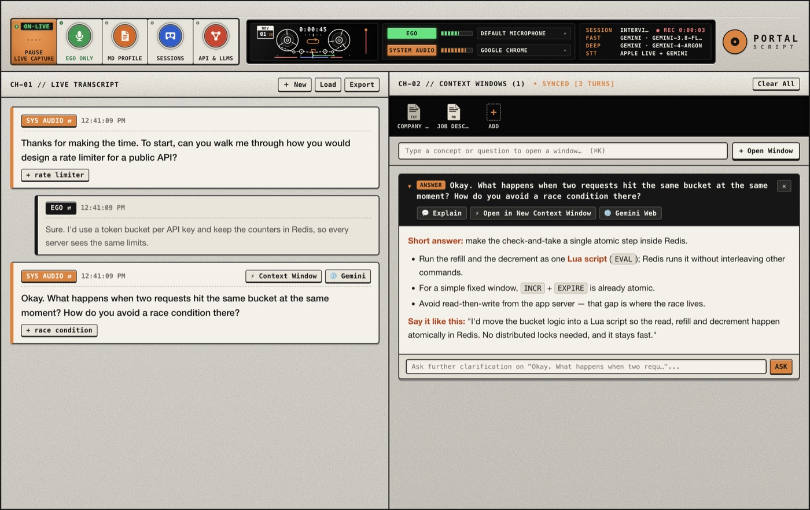

### Explain a term or phrase

1. Select a word or phrase in any line. The line's button changes to **⚡ Open "…"**.

   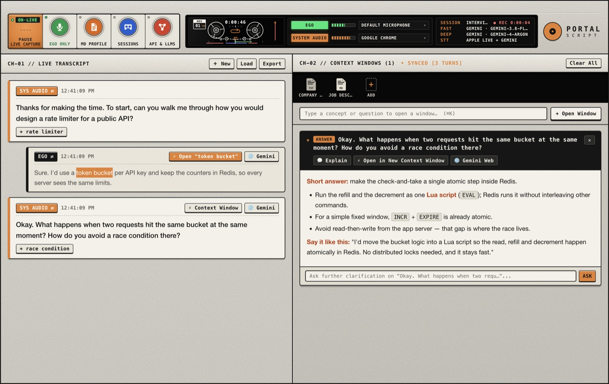

2. Click it. A new context window explains the phrase in the context of the conversation.
   Older windows collapse but stay saved below.

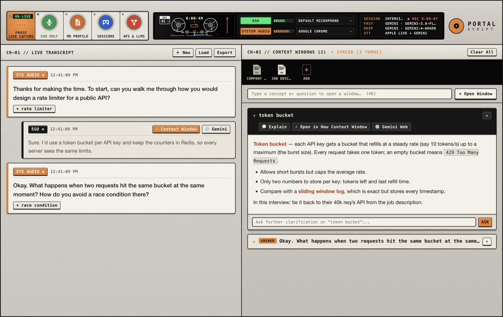

Inside a window you can also:

- **Explain**: select text in the window and go deeper on it.
- **Open in New Context Window**: select text in the window and open it on its own.
- **Gemini Web**: continue the conversation in Gemini in your browser.

### Right-click menu

Right-click any line, or a selection, to search it in a new context window, open it in Gemini in your
browser, or copy it.

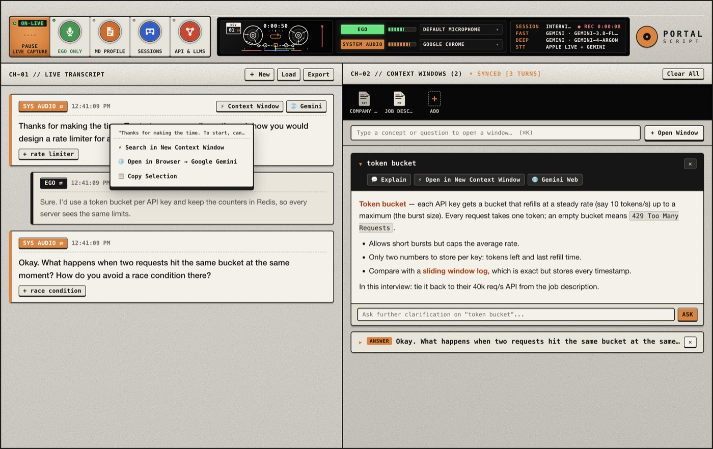

> Opening something in the browser asks for confirmation first, because it sends the text to
> gemini.google.com. See [Privacy](../PRIVACY.md).

## 9. Find, export and reopen sessions

1. Click **SESSIONS** (or **Load** above the transcript).
2. Each row shows the number of lines and context windows, and where the session is saved.
   - **Load Session**: reopen it. Your current session is saved first.
   - **Export**: save the transcript as `.md` or `.txt`, with timestamps.
   - **Finder**: open the session folder.
3. **Load Folder…** opens a session folder from somewhere else, such as a backup.

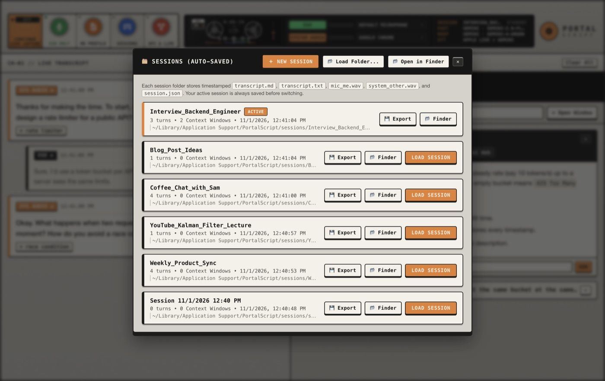

Each session folder contains:

| File               | What's in it                                              |
| ------------------ | --------------------------------------------------------- |
| `transcript.md`    | The transcript with timestamps and speaker labels         |
| `transcript.txt`   | The same, as plain text                                   |
| `mic_me.wav`       | Recording of your mic                                     |
| `system_other.wav` | Recording of the system or app audio                      |
| `session.json`     | Transcript, AI answers and the text of your context files |

By default sessions live in `~/Library/Application Support/PortalScript/sessions` and never leave
your Mac. What does go out is audio to a cloud speech engine (if you picked one) and text to your AI
provider. See [Privacy](../PRIVACY.md) for exactly what's sent and when.

## Keyboard shortcuts

| Key                                    | Action                                           |
| -------------------------------------- | ------------------------------------------------ |
| <kbd>Space</kbd>                       | Start or pause capture                           |
| <kbd>⌘</kbd> <kbd>K</kbd>              | Jump to the "type a concept or question" box     |
| <kbd>Esc</kbd>                         | Close a menu or dialog, then clear the selection |
| <kbd>⌘</kbd> <kbd>⇧</kbd> <kbd>D</kbd> | Show the manual input bar (developer tools)      |
